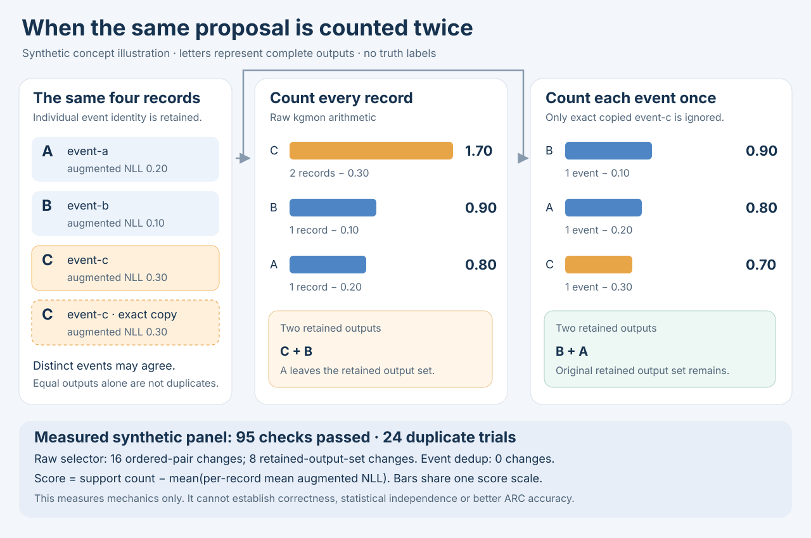
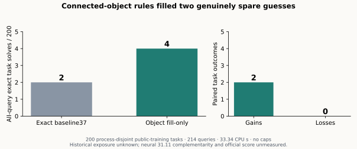

# arc-prize-2026-arc-agi-2
ARC-AGI-2 experiments, notebook provenance, runtime studies and verified Kaggle progress for prvsiyan.

## Latest reproducible tool · 14 October

[Proposal-origin support probe](proposal-origin-support-2026-10-14/README.md) checks whether copying the same proposal changes a count-based selector. The original dependency-free tool passed **95 checks**: among **24 invented duplicate trials**, raw support changed the ordered pair in **16** and the retained answer set in **8**; counting each declared event once changed neither. It includes runnable examples, source-bound measured results and a diagram. These are synthetic mechanics; their effect on real ARC accuracy remains unmeasured.

## Earlier measured experiment · 12 October

[Connected-object selection](object-selection-2026-10-12/README.md) adds two solves to an owned baseline on a 200-task public-training screen: **2 → 4 solves, two gains and no losses**. The folder includes runnable controls, source pins and a reproducible chart. Its benefit alongside the 31.11 neural control remains unmeasured.

## Earlier experiments worth reading

Existing public campaign notebook: [ARC-AGI-2 Public Frontier Perfpatch Evidence Lab](https://www.kaggle.com/code/prvsiyan/arc-agi-2-public-frontier-perfpatch-evidence-lab). This stable identity was observed public in the retained 11 October snapshot; the guide makes no current run-status or score claim.

The permanent archive includes [Stable seed binding](https://github.com/cubres/arc-prize-2026-arc-agi-2/blob/8c4193dbbd45802e1256b2e46d70fe89f2c74fbc/tools/stable-seed-binding/2026-10-06/README.md) and [CPU object-relational discovery](https://github.com/cubres/arc-prize-2026-arc-agi-2/blob/9f74e7618dcc28a221119fb8fc5c91c54d5723e1/cpu-object-relational-discovery-2026-10-10/README.md). Read their original claim limits and provenance before a fork. Failures and unexecuted ideas remain part of the record; invented controls are separate from native qualification and official scores.

The shared [Static notebook execution map](https://github.com/cubres/gemma-4-developer-agent/blob/4b21f05ee4542c9f0c5a9dfd2a6d7081385af6d7/tools/notebook-execution-map/2026-10-05/README.md) provides a read-only first look at direct configuration bindings. It does not execute notebooks or infer effective runtime.
