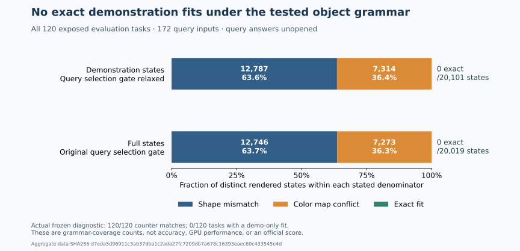

# Why this object grammar does not activate on ARC2 evaluation inputs

The tested connected-object grammar produced no exact demonstration fit on any of the 120 retained exposed evaluation tasks. An input-only diagnostic relaxed the query-selection gate and still found zero fitting demonstration states. The result identifies insufficient coverage of this specific grammar on this panel; it gives no evidence of a gain in query accuracy or neural complementarity.

The completed measurement used public demonstration input/output pairs and 172 query inputs. It did not open the separate query-solution file. The portable diagnostic distributed here is a **SOURCE_ONLY_PUBLIC_VARIANT**: its synthetic controls passed, but it has not reproduced the real-panel measurement. The published counts come from the separately reviewed, completed frozen diagnostic on 12 October 2026.



## What was tested

For each input grid, the grammar tries background zero, the most frequent color, and the most frequent border color; four- or eight-neighbor connectivity; and mixed-color or single-color objects. At least one demonstration must contain multiple objects. Thirteen selectors choose a unique object by size, position, shape, or color-set properties. A program then crops, isolates, retains, or erases that object, applies one of eight grid symmetries, and fits one global color map across every demonstration.

The original search requires its selector to work on both demonstrations and query inputs before testing the demonstration outputs. Consequently, a query tie can hide a demonstration-fitting program from its exact-fit counter. Tiny invented controls reproduce that behavior. The diagnostic checks demonstration fitting separately so that this accounting limitation cannot explain the real panel by itself.

## Measured coverage

All 120 tasks and all 172 query inputs were retained. No task was selected using query answers, and no task was excluded for failing the diagnostic. The original per-task counters matched the completed prediction trace for **120 of 120 tasks**. The diagnostic took 14.637 wall seconds and 11.500 CPU seconds on the local CPU; these timings describe this diagnostic, not a neural model or a Kaggle accelerator run.

| Distinct rendered-state denominator | Shape mismatch | Color-map conflict | Exact demonstration fit |
| --- | ---: | ---: | ---: |
| Demonstration states, query-selection gate relaxed: 20,101 | 12,787 | 7,314 | 0 |
| Full demonstration-plus-query states, original gate: 20,019 | 12,746 | 7,273 | 0 |

Each row is a complete partition of its stated denominator. Demonstration states are deduplicated by demonstration shapes and bytes; full states are deduplicated by both demonstration and query shapes and bytes. The two rows therefore use different equivalence classes. Their difference is not a count of rescued programs or tasks.

There were **0 of 120 tasks** with a demonstration-only exact fit and **0 of 120 tasks** with a fitting demonstration program blocked by query selection. The search completed without a per-task cap. Query gating can suppress fits in principle, but it did not cause this panel's zero activation.

The intermediate gate counts also reveal substantial restriction: 1,259 of 1,440 object decompositions passed the multiple-object predicate. Of 16,367 selector attempts, 5,682 selected objects in every demonstration; 1,011 of these then failed query selection. None of the separately examined demonstration outputs matched the required demonstration targets. Gate counts count decomposition or selector attempts; they are not task counts.

## What the controls establish

The seven invented controls are included in the Python source. Their expected outputs are handwritten and are not copied from benchmark tasks. The identity crop and supported recoloring cases each produce the expected candidate. Conflicting demonstrations reject; an unobserved query color rejects a nonidentity map after an exact demonstration fit; a single-object demonstration triggers the multiple-object restriction. Empty and tied query inventories each suppress 576 fitting program families in their toy case.

These controls establish that the matcher can activate and that the diagnostic distinguishes its rejection stages. They do not establish that the grammar solves ARC2 tasks. No query accuracy, official score, neural complementarity, or GPU improvement is claimed here. Historical human exposure to these exposed tasks is unknown.

## Next operator hypotheses

Two specific additions warrant small invented-control implementations before another model run. They address limitations of the existing grammar; neither has demonstrated a fit or a quality gain on this panel.

**Two-anchor interval painting** would preserve the input canvas, select a unique eligible pair of anchors on a row or column, and paint blank cells strictly between them. Its positive controls should vary anchor position, spacing, and canvas size, while retaining other blank cells so one global recoloring cannot imitate the operation. Negative controls should reject contradictory demonstrations, attempts to overwrite an intervening colored cell, and multiple eligible query pairs that produce different outputs. This tests a spatially conditional change that the current single-object rendering and global color map cannot express.

**Repeated-component group selection** would select all members of one uniquely repeated translation-normalized shape class, bounded to two through four components, then crop their isolated union. An invented positive control can use two vertical dominoes separated by blank columns plus an unrelated singleton; the expected output preserves both dominoes within their union crop. A second control should vary offsets and include an unrelated component inside the union box. Negative controls should reject two eligible repeated classes, a demonstration target omitting a selected member, and ambiguous query groups. This tests composition of several objects, which the current single-object crop cannot express.

The admission criterion for either family is a handwritten positive control that activates the intended operation, negative controls that reject ambiguity or inconsistency, and a bounded demonstration-only coverage screen. Dimension compatibility alone does not establish a fit. Existing rotations, reflections, and whole-grid scaling or tiling already belong to the baseline and do not by themselves address the measured object-grammar failure.

## Reproduction

Use POSIX Python with NumPy. The completed frozen measurement used Python 3.12 and NumPy 2.2.6. For the portable source, begin with the synthetic check:

```sh
python3 -I -B activation_diagnostic.py --self-test
```

Obtain the challenge file through an authorized competition download; raw benchmark grids are not redistributed in this packet. The default byte and inventory pins bind the exact 120-task, 172-query panel used for the published aggregate. Supply the challenge path and a fresh output directory whose parent already exists:

```sh
nice -n 5 python3 -I -B activation_diagnostic.py \
  --challenges /path/to/arc-agi_evaluation_challenges.json \
  --out /path/to/new_activation_audit
```

The portable command accepts no query-solution path or prediction-trace path. Its runtime forbids file reads, network access, and child processes after inputs and helpers are loaded. It uses exclusive output creation, 1.5 CPU seconds per task, 210 total CPU seconds, and a 240-second wall limit. A capped or failed invocation produces no qualified measurement. Its aggregate output reports its own source and input hashes. It does not assert parity with the private prediction trace; that parity belongs to the completed frozen measurement.

The plot is generated directly from [coverage_counts.json](coverage_counts.json), with explicit partition assertions and the data hash embedded in the figure. To regenerate it, use fresh output filenames:

```sh
python3 -I -B plot_coverage.py --data coverage_counts.json \
  --svg coverage_partition_reproduced.svg \
  --png coverage_partition_reproduced.png
```

The plotting command additionally needs Matplotlib. `requirements.txt` records the package versions used for the synthetic source checks and the supplied figure. The portable real-panel command has not been executed in this packet.

## Source and attribution

The diagnostic, figure generator, and analysis are original work. `baseline37.py` is the original bounded grid-search helper and remains under the included MIT terms in `BASELINE_LICENSE`. `object_selector.py` is an independently written connected-object implementation under the included Apache 2.0 terms. Its original concept credit to the BlackCat V2 object-selection supplementation notebook is retained in its docstring; no BlackCat source body is included.

The packet contains only original source, its helper licenses, invented synthetic controls, aggregate evidence, and the plot. It contains no benchmark grids, task identifiers, query solutions, credentials, or local machine paths. [coverage_counts.json](coverage_counts.json) binds the published aggregate to the completed frozen diagnostic and records the source-only status of this portable variant.
