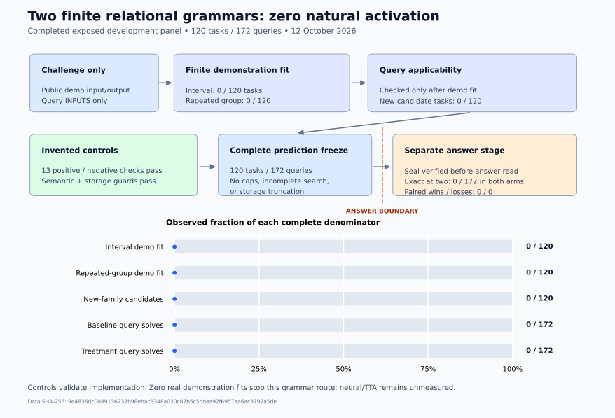

# Two relational grammars, zero activation on ARC-AGI-2

Two original bounded program families passed thirteen invented positive and negative controls, but neither fitted the public demonstrations of any task in the complete 120-task, 172-query exposed evaluation panel. The completed CPU comparison consequently added no predictions and solved no queries in either arm. This is a useful negative result: these specific grammars have no demonstrated coverage on this panel.



## The measured experiment

| Endpoint | Result | Denominator |
| --- | ---: | ---: |
| Interval-painting demonstration fit | 0 | 120 tasks |
| Repeated-component demonstration fit | 0 | 120 tasks |
| Any new family supplies query candidates | 0 | 120 tasks |
| Frozen baseline exact at two | 0 | 172 queries |
| Baseline plus relational families exact at two | 0 | 172 queries |
| Paired query wins / losses | 0 / 0 | 172 queries |
| Baseline time caps / incomplete structural searches / storage truncations | 0 / 0 / 0 | 120 tasks |

The root coordinator ran the exact byte-pinned source on 12 October 2026, retained all 120 tasks and all 172 queries, and completed prediction before opening the separate query answers. The public aggregate reports 31.473 seconds of prediction wall time and 26.770 seconds of prediction CPU time, including 11.743 seconds attributed to the structural solver. Evaluation took 0.0145 wall seconds. These are local CPU measurements on macOS arm64 with Python 3.12.14 and NumPy 2.2.6.

The primary endpoint matches each query against either of two attempts independently. The stricter secondary endpoint requires all queries of a task to match one joint attempt; both arms scored 0 of 120 tasks on that endpoint. No official submission or accelerator run was performed for this experiment. Historical exposure of the evaluation panel is unknown, so this is exposed development evidence. Neural complementarity was not measured.

`aggregate_result.json` contains only the qualified public aggregate and input-only coverage receipt. It preserves the challenge, solution, source, protocol, and sealed-prediction hashes. It contains no task identifiers, benchmark grids, predictions, or answers. The published source contains invented control grids only.

## What the programs can express

The interval family preserves the canvas and fills blank cells strictly between two eligible anchors in a row or column. The grammar varies background policy, anchor colors, blank-gap rules, one-pair versus all-pairs scope, and fill color. Existing colored obstacles are preserved. The repeated-component family identifies exactly one eligible whole equivalence class of two to four components, then crops its union, retains it, or erases it, optionally applying a geometric symmetry. It never silently selects four members of a five-member class. Each family has 3,456 finite parameter combinations.

Both families test direct equality against every demonstration output before testing query applicability. A task whose demonstrations all leave their inputs unchanged admits no new-family candidates. Demonstration-state caching preserves the associated program semantics; storing the first sixteen distinct joint predictions does not stop finite enumeration. The frozen baseline's first two guesses remain protected in the treatment. These mechanisms, the demonstration-before-query boundary, conflicting examples, obstacle preservation, ambiguous queries, complete joint predictions, and storage-cap independence have independent synthetic checks in `controls.py`.

The controls establish that implemented routes can activate on invented examples and reject specified invalid cases. They do not establish coverage or accuracy on ARC. Because real demonstration fits are zero before any query ambiguity checks, the observed result is not explained by an overly strict query gate. It is a failure of this limited grammar to cover the panel.

## Why this route stops

The earlier single-component experiment also found zero exact demonstration fits after an input-only stage diagnostic. Adding two relational families supplied no activation, no added guesses, and no paired improvement. Repeating the same search on a GPU would not change its expressive scope. There is no measured basis to integrate or tune these operators further for this campaign, and no basis to claim they complement a neural model.

The next useful source direction is demonstration-conditioned neural adaptation and augmented candidate selection from a version-bound scored public notebook. [METHOD_NOTES.md](METHOD_NOTES.md) explains the source findings and a future controlled comparison. That adaptation remains unimplemented and unmeasured here. The separate neural launch workflow remains stopped at its existing approval block; this packet does not authorize or replace it.

## Fork and reproduce

Fork this repository and work in this folder. Install `requirements.txt` in a Python 3.12 environment. The solver requires NumPy; Matplotlib is needed only to redraw the figure. The frozen driver uses POSIX CPU limits and alarm signals, so run it on macOS or Linux.

Run the invented controls without acquiring any benchmark data:

```sh
python3 -I -B check_controls.py
python3 -I -B plot_relational_coverage.py --out-dir YOUR_NEW_FIGURE_DIRECTORY
```

The first command checks the original seven source/license pins and runs all thirteen controls; the second creates new SVG/PNG files from the aggregate. It refuses an existing output directory. This wrapper and figure script are publication helpers, not part of the measured solver. The wrapper has been checked only on invented controls.

Acquire the exposed challenge and solution files independently under their applicable competition terms. Dataset files are not distributed here. The preregistered protocol requires the exact challenge SHA-256 `e7c62a4bd211867c6b538f66b8013b81f299663c82ca062f49a52bf439d6e4e8` and solution SHA-256 `84be4f4f39b79e82c36d565fc878830988b094917f052ee7069aef30b33ca8f1`. There are 120 tasks and 172 query inputs. Do not edit the source or protocol if reproducing this experiment; a changed method needs a separately registered experiment.

On an idle CPU, run prediction into a new directory, preserving any failed or partial output:

```sh
nice -n 5 python3 -I -B run_relational_eval.py predict \
  --protocol PROTOCOL.json \
  --challenges YOUR_EXACT_CHALLENGE_JSON \
  --out YOUR_NEW_RUN_DIRECTORY
```

Prediction accepts no solution argument. It verifies the complete input inventory, source pins, and thirteen controls, then denies network access, children, and filesystem reads while solving. The registered limits are 0.8 CPU seconds for the interval family and 0.4 for the group family per task, a 400/410-second process CPU limit, and a 420-second process wall limit. The original coordinator also enforced a 450-second total parent budget across prediction and optional evaluation, with no overlapping worker. Reproduction requires an equivalent outer total budget; the two child invocations alone do not enforce that shared parent budget.

Only after prediction exits successfully with a qualified complete marker, no failure marker, and all 120 tasks/172 queries sealed, run the separate score stage:

```sh
python3 -I -B run_relational_eval.py evaluate \
  --protocol PROTOCOL.json \
  --solutions YOUR_EXACT_SOLUTION_JSON \
  --out YOUR_NEW_RUN_DIRECTORY
```

The score stage revalidates the protocol, sources, seal, completion receipt, protected baseline attempts, and prediction schemas before its first solution read. A timeout, incomplete finite search, source mismatch, or failed receipt disqualifies the run; preserve it and register any subsequent experiment separately. Private outputs include per-task predictions and scoring records: do not publish them with this packet.

`PROTOCOL.json` is the unchanged pre-run registration. Its `SOURCE_ONLY_NOT_ACTUAL_RUN` status describes the registration when written. It is retained byte-for-byte because the completed receipt binds its hash; the actual result is recorded separately in `aggregate_result.json`. The exact solver bytes ran locally, whereas a reader's new fork or helper invocation is not a new measured benchmark result.

## Source and licences

The relational operators, controls, runner, helper scripts, diagram, and analysis are original cubres campaign work under the included Apache 2.0 terms. `baseline37.py` is the original owned grid-search helper under the included MIT `BASELINE_LICENSE`. `object_selector.py` is independently written under Apache 2.0; it retains concept credit to the BlackCat V2 object-selection supplementation notebook in its docstring. No BlackCat source body is included.

The attributed neural source is discussed by method only. No third-party notebook, model weights, raw score receipt, competition dataset, or benchmark answer is redistributed. Refer to their original owners and applicable terms before obtaining or adapting them. See `METHOD_NOTES.md` for the exact source-version attribution and the limits of its score binding.
