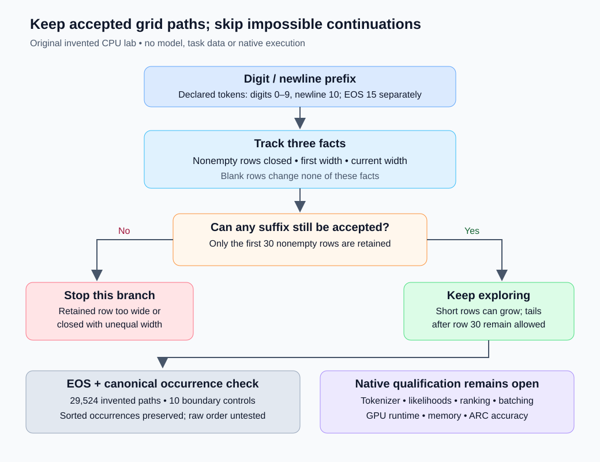

# ARC2 parser lab: reject only irreparable grid prefixes

This original CPU lab tests a small decoder idea: stop exploring a token prefix only when no continuation can pass the published grid parser. It preserves that parser's permissive treatment of blank rows and long tails. It contains no model, competition task, upstream implementation, checkpoint, or training code.

The behavior studied comes from Koushik Rudra's Apache-2.0 [Failed in AIMO, version 1](https://www.kaggle.com/code/koushikrudra/failed-in-aimo?scriptVersionId=312063593). Its parser drops empty rows, keeps the first 30 nonempty rows, and accepts rectangular grids with 1–30 rows and columns. Its decoder intends digit tokens 0–9, newline 10, and EOS 15. This lab independently expresses those source-level rules; it does not execute the notebook or its tokenizer. The public notebook's score belongs to its author and does not qualify this idea.



## Run the lab

Use Python 3.9 or newer; only the standard library is needed. From this directory:

```sh
python3 verify_prefix_viability.py --out result.json
```

The output path must not already exist. Choose a new filename for another run; the tool preserves existing results. The command performs invented CPU checks only and makes no network request. It does not load a model or submit anything. The recorded run used one worker at nice 5 with a 30-second CPU limit and 45-second wall alarm; the tool itself does not install these outer limits.

## What the checker retains

- Blank rows remain allowed. A short unfinished row remains viable because more digits can complete it.
- An oversized first row, a later row already wider than the first, or a closed unequal-width retained row is irreparable.
- Once 30 consistent nonempty rows have closed, the parser discards every later row. The checker therefore leaves that tail unrestricted.
- EOS is handled separately. This checker assumes the declared digit/newline body alphabet; it is not a validator for arbitrary token IDs, especially after row 30.

The proposal would leave logits, cumulative likelihoods, probability cutoff, training, augmentation, seeds, and final selection unchanged. It has not been integrated into a neural solver. Pruning can nevertheless change batching and finite-time search trajectories, so source-level language preservation does not establish numerical or output parity on a GPU.

## Actual invented-fixture result

The frozen original tool and an independent rerun agreed on:

| Check | Result |
|---|---:|
| EOS-terminated paths, body lengths 0–9 over digits 0/1 and newline |29,524|
| Explicit width, blank-row and 30-row boundary controls |10|
| Accepted token-path occurrences retained |7,002|
| Irreparable token paths |18,328|
| Synthetic nonterminal expansions, unpruned → pruned |9,841 →4,745|

The original run used 0.185205 CPU seconds; the independent rerun used 0.186851 CPU seconds. Timings depend on the machine and do not measure GPU inference. The full safe aggregate is in [aggregate-result.json](aggregate-result.json). Its fixture sourceSHA256 is `e03376064aa7de87578f27a146c6f1772879fca4a18804a38934b5dd418714cf`.

The fixture compares **sorted token-path occurrences**, so its equality check establishes canonical occurrence preservation. It does not independently test raw DFS emission order. Its invented path-cost/grid digest is computed from the reference paths; it is not a separately computed treatment likelihood digest. Two digits represent a digit class for these width rules; this finite enumeration is not exhaustive over every length or actual tokenizer behavior.

**Qualification: invented language fixtures only.** Actual tokenizer decoding, execution of the foreign parser, native likelihoods and rescore vectors, candidate order, top-two ranking, batched cache/position behavior, runtime, memory, ARC accuracy, and official score benefit remain untested. The expansion counts are properties of an invented complete tree; they are not measured native model-call savings or a speedup. A future instrumented solver would first measure how many real prefixes are irreparable, then require matched numerical, candidate, ranking, runtime and memory checks before adoption.

All code, documentation and the diagram in this lab are original and released under Apache-2.0. See [NOTICE](NOTICE) for attribution and [LICENSE](LICENSE) for terms.
