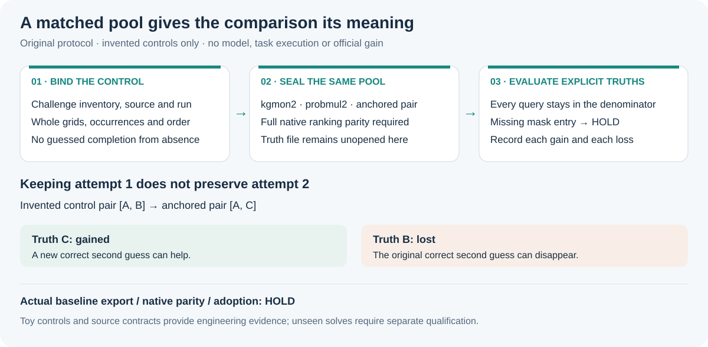

# Compare two guesses without changing the candidate pool

A small original audit tool for selector experiments. It does not train, decode, run ARC tasks, restore a notebook, build a submission or call a service. The example uses invented one-cell grids only.



Two complete guesses provide a limited budget. Keeping the first guess while replacing the second can remove a correct answer. The supplied toy makes that tradeoff explicit: both alternative selectors gain one invented query and lose another. Their net change is zero. Neither result establishes a competition benefit.

Read [the candidate-prefix versus serialized-submission boundary](SUBMISSION_BOUNDARY.md) before interpreting hit fractions. Zero/one-candidate padding and runtime repair remain unqualified.

## Three matched controls

Every selector receives the same ordered occurrence records and complete grids.

| Control | What it selects |
| --- | --- |
| kgmon2 | First two distinct grids ranked by occurrence count minus the mean of each occurrence's mean augmentation score |
| probmul2 | First two distinct grids ranked by the baseline-three beam/view aggregation |
| anchored_distinct2 | First kgmon grid, then the first different probmul grid, with a second-kgmon fallback |

The two scoring formulas are credited to [Koushik Rudra's Apache-2.0 Failed in AIMO V1 decoder](https://www.kaggle.com/code/koushikrudra/failed-in-aimo?scriptVersionId=312063593). This is an independent standard-library implementation and an original audit protocol. No downloaded implementation, model or task data is distributed. The first-slot portfolio is a hypothesis also present in public NVARC selector work; it is not presented as a newly discovered model method.

Repeated occurrences of the same grid form one group. Group ties retain the order of the first occurrence. Augmentation means are taken per occurrence; flattening different-length view lists changes the objective. Full grid SHA256 includes its shape and content. `[[0]]` is a valid grid, not a timeout flag.

Python summation may differ from the original NumPy reduction near ties. Therefore the tool requires the full CPU rankings to agree with native rankings exported from the same loaded pools. That parity is **not tested here**. The fake ranker in the invented adapter witness uses this same arithmetic and cannot qualify native parity.

## Run the invented controls

Python3.10+ on POSIX, standard library only. In a fresh copy of this folder:

```sh
python3 -B invented_controls.py
```

The script creates a new `INVENTED_RESULT.json` exclusively. The previously measured example is `RECORDED_INVENTED_RESULT.json`; preserve both. If the new output already exists, use a new non-notebook experiment folder rather than removing or overwriting it. The script imposes a ten-second CPU bound and requires no downloaded data or weights.

The retained run passed27 narrowly targeted controls. It checks both gains and losses, group order, variable-length views, exact inventory, source/seed drift, immutable input pools, full-ranking versus top-two comparison, explicit missing/unknown truths and generation-state coverage. The native capture adapter itself remains a source candidate, not an executed Kaggle integration.

## Seal before evaluating

`selector_audit.py` accepts only pinned JSON files, at most64MiB each. It never loads a pickle. `prepare` validates the registration, identity, source/run bindings, every registered query and the native selector rankings. It creates a new seal without accepting a truth file. A separate `evaluate` call checks the seal first, then opens the truth mask.

```sh
python3 -I -B selector_audit.py prepare \
  --registration REGISTRATION.json --registration-sha256 REGISTRATION_FILE_SHA256 \
  --export CANDIDATES.json --export-sha256 CANDIDATES_FILE_SHA256 \
  --out NEW_SEAL.json

python3 -I -B selector_audit.py evaluate \
  --registration REGISTRATION.json --registration-sha256 REGISTRATION_FILE_SHA256 \
  --export CANDIDATES.json --export-sha256 CANDIDATES_FILE_SHA256 \
  --seal NEW_SEAL.json --seal-sha256 SEAL_FILE_SHA256 \
  --truth-mask TRUTH_MASK.json --truth-mask-sha256 TRUTH_MASK_FILE_SHA256 \
  --out NEW_DIAGNOSTIC.json
```

The placeholders are externally verified file SHA256 values, including the exact serialization. Internal JSON-object digests use canonical compact JSON and are a different binding. Hashes check consistency, not publisher authentication, source chronology or permission. The code's opening order does not prove that another process or the checkpoint never saw those truths. A public panel with possible training exposure is a development diagnostic.

Every registered query stays in the denominator, including explicit empty pools. A missing truth-mask entry is HOLD. An explicitly unknown truth retains its place in query/puzzle bounds and prevents truth-complete qualification. Report each gained and lost output, query fractions and per-puzzle mean fractions separately. No result automatically promotes a selector or claims an official score.

## Repairing an earlier gate without changing its threshold

The separate `repaired_legacy_g2` function is an original shadow audit. It keeps its pinned old expected pool count at12. Observing13 returns FAIL_DISCREPANCY; it never widens the rule. It checks a shared truth retained by both controls even when their ordered pairs differ. Missing C/D is explicit in full-five mode; an A0/A1/B-only diagnostic never qualifies the five-arm study. It does not implement G3–G10, native scientific gates or adoption. Opaque legacy tokens are diagnostics, not proof of full grid identity.

## Native capture candidate and limits

`capture_loaded_pool.py` accepts an already loaded trusted decoder from the same reviewed run. It contains no file/pickle/model/task loader. It refuses attached test replies, unregistered queries, missing or unfinished generation-state coverage and native selectors that mutate pools. Each query's complete/empty-complete state must come from source-bound generation receipts, not an inference from an absent pool. Ordinal view positions preserve order; augmentation meanings need the separately bound source and seed logs.

Its run binding includes native id/version, notebook source hash, generation receipt hash and loaded-module manifest hash. None has been measured for an actual baseline export in this packet. Such an export is still absent; actual native parity, source/environment identity, rights, science, runtime and adoption stay HOLD. Faster arithmetic and a local gain on reused truths do not establish unseen solves.

Original code, prose and diagram are MIT licensed. They grant no rights to competition data, checkpoints or third-party implementation. No existing notebook, source identity, guard or image is modified by these tools.
