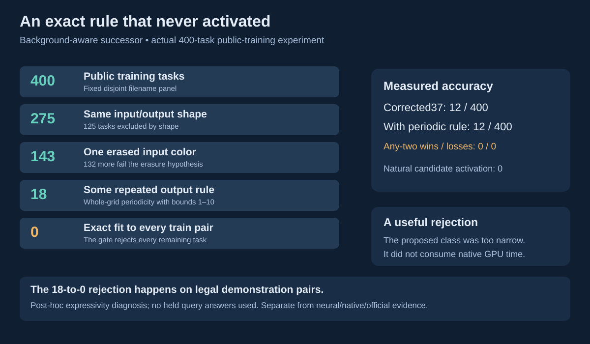

# An exact rule that never activated

**Start with [the complete baseline and reproduction guide](BASELINE_AND_REPRODUCTION.md).** The exact owned corrected37 source is included at [`baseline37/program_search.py`](baseline37/program_search.py), together with its original meaningful controls and MIT terms. No separately available source is required.

A repeated pattern with a covered cell looks like an attractive cheap second guess. We tested that idea before spending native GPU time. Two original periodic-completion variants produced **no natural candidates and no accuracy gain** on their fixed public-training panels.

| Frozen experiment | Tasks | Corrected37 top-one / any-two | With periodic rule | Any-two wins / losses | Worker wall |
| --- | ---: | ---: | ---: | ---: | ---: |
| Strict visible-lattice evidence | 200 | 8 / 8 | 8 / 8 | 0 / 0 | 24.33 s |
| Demonstrated background classes allowed | 400 | 12 / 12 | 12 / 12 | 0 / 0 | 62.46 s |

The task endpoint requires one entire joint candidate to match every query output. It does not mix successful guesses from different candidates across queries, so it can be stricter than a per-query competition endpoint.

Both variants had zero activation, zero prediction changes and zero per-task time caps. The periodic calls took 0.0369 s and 0.1090 s in total, respectively. These public training results are separate from the campaign's neural candidates, native execution and official competition scores. They provide no evidence that this rule improves the 31.11 neural reference.



The successor's post-hoc demonstration-and-query-input diagnosis is useful: 275/400 tasks preserve grid shape, 143 also have one input color responsible for every changed pixel, and 18 support some repeated whole-grid output rule. **None reconstructs every demonstration exactly under the proposed rule.** The gate rejects the method before query answers could justify it. This is a narrow grammar with poor measured coverage, rather than a successful frontier component.

## What the rule actually does

For each task, fit row/column periods up to ten using demonstration outputs. A variable-size axis may be left uncontracted. Infer one erased input color from changed demonstration pixels; every train pair must have the same shape and one shared erased color. Query colors come from the query's visible cells, with no stored puzzle solution or color template.

`strict_periodic.py` requires a visible, consistent observation for every residue class. `periodic_completion.py` additionally permits a missing class to remain erased color when **every demonstration output** certifies that class as erased color. Unknown classes outside that intersection still cause abstention. Both implementations require exact reconstruction of all demonstrations and deduplicate predictions across all queries jointly.

The overlay preserves a populated baseline first guess. A distinct fitted periodic guess can replace its second guess, so the comparison explicitly counts potential replacement losses. With an empty baseline, up to two periodic guesses may be used. No slot changed in the actual measurements.

## Reproduce the measured panels

This pack includes the exact corrected37 baseline and its preceding semantic reference for the original controls. It excludes puzzle grids, query answers and private neural code. The included `baseline37/program_search.py` has the exact required SHA256 `52141a1eb17b5d33b2c528f8571b16eef9f4e784f7a8873d3f62f59f31d1c2cf`. On Unix, Python 3.10+ with NumPy and Requests is sufficient. The original run used Python 3.12 and NumPy 2.2.6; the successor's captured environment is in `ACTUAL_AGGREGATE_EVIDENCE.json`.

```sh
python3 -m pip install -r requirements.txt
python3 -B -m unittest discover -s baseline37 -p test_program_search.py -v
python3 -B reproduce.py prepare --arm background --baseline ./baseline37/program_search.py --work ./my-background-run
nice -n 5 python3 -B reproduce.py predict --arm background --work ./my-background-run
python3 -B reproduce.py evaluate --arm background --work ./my-background-run
```

Use `--arm strict` and a separate fresh work directory for the 200-task first experiment. Existing outputs are preserved through exclusive creation. The adapter's preparation downloads only the exact immutable public training files in `PUBLIC_PANEL_METADATA.json`, checks every Git blob/byte count, and separates challenge inputs from held answers. Prediction loads no answers, passes neither task IDs nor query outputs to either policy, seals the full two-arm predictions, and rejects later file/network accesses beyond the declared output files. Evaluation opens answers after the complete prediction seal and unique task coverage gate.

`reproduce.py` is a publication adapter, distinct from the actual measured workers. The original source freezes, panel hashes, prediction/result hashes, actual aggregate results and timing are recorded in `ACTUAL_AGGREGATE_EVIDENCE.json` and `PUBLIC_PANEL_METADATA.json`. The pack's publication adapter was not rerun on all 600 tasks; its syntax, CLI and staged synthetic smoke check were verified separately. Hardware and time limits can change a bounded baseline result; incomplete runs are not comparable results.

The first experiment excluded the earlier 100 development and 100 validation filenames, then chose 200 of the remaining 800 using hash order. The successor excluded those 200 additional filenames and chose 400 of the remaining 600. Selection and solver sources were frozen before downloading each new panel's grids. Historical human/model exposure is unknown. All panels come from the official **training** directory, not ARC2 public or hidden evaluation. The first experiment's chain check was recorded after scoring; the successor had an additional complete source/protocol/panel/challenge/prediction verification before answer access.

The audit is a Python later-access audit after imports and legal challenge/source reads, not an OS sandbox. CPU limits are OS-enforced; the wall limit is checked cooperatively between tasks. These limitations are retained alongside the negative result.

## Provenance

Solver and experiment tools were implemented independently for this campaign; no competing solved-task programs or model weights were copied. The original component code is offered under its separate MIT license. Puzzle metadata identifies public files at [ARC-AGI-2 commit f3283f7](https://github.com/arcprize/ARC-AGI-2/tree/f3283f727488ad98fe575ea6a5ac981e4a188e49/data/training); the official data retains its [Apache 2.0 license](https://github.com/arcprize/ARC-AGI-2/blob/f3283f727488ad98fe575ea6a5ac981e4a188e49/LICENSE). No puzzle contents are redistributed in this pack.
