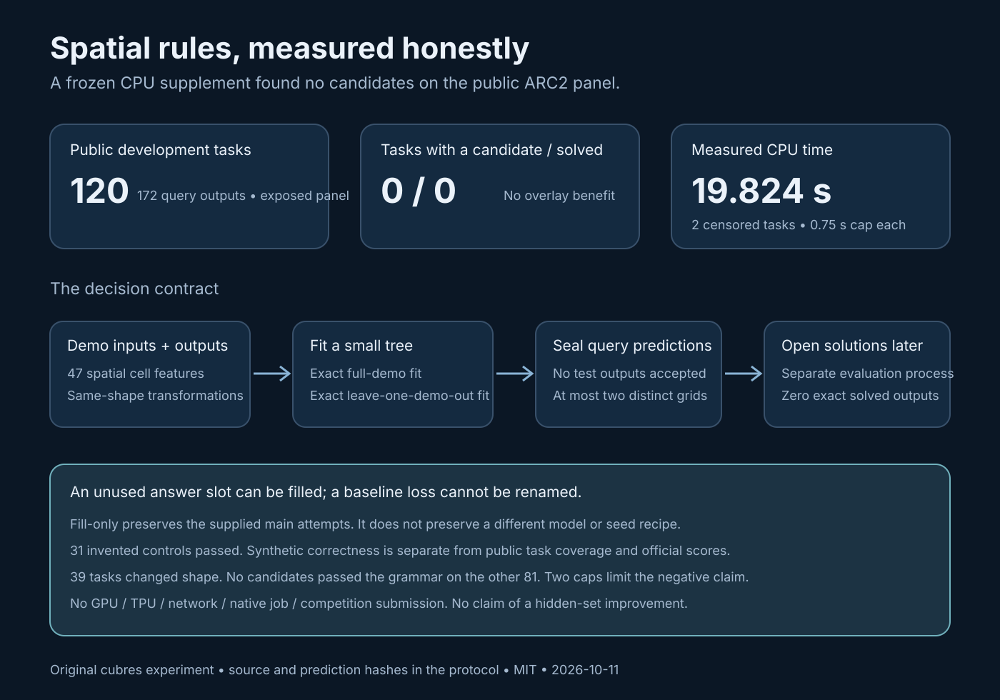

# Spatial decision programs: a short experiment that did not work

We tried an original CPU supplement for same-size ARC transformations. It reads
the demonstrations, describes every cell with 47 spatial features, and learns a
small decision tree. A program earns a query prediction only if it reproduces
every demonstration exactly **and** every demonstration can be predicted from
the remaining examples. We fixed the features, three configurations, ranking,
and CPU cap before prediction. The query solutions were opened in a separate
evaluation process after predictions were saved and hashed.

The result is negative: **zero candidates and zero solves on 120 public tasks
(172 query outputs)**. The prediction phase took 19.824 CPU seconds and 19.855
wall seconds. Two tasks reached the 0.75-second per-task cap; those are censored,
so the experiment does not prove that no tree could fit them. A same-size grammar
could apply to 81 tasks; the other 39 changed shape in their demonstrations.
Thirty-one invented controls passed, including a ring-fill example and copying
previously unseen colors. Those controls establish some implemented behaviors,
not performance on ARC2.



This is useful as a small, inspectable baseline for future relational features.
It is **not a recommended scoring overlay**. No pretrained model, task-ID
lookup, stored answer, GPU, TPU, network, Kaggle run, or competition submission
was used. The solver accepts demonstration pairs and query inputs only. This
public panel was already exposed to previous campaigns and may occur in model
training; a fresh prediction seal does not make it an unseen panel.

## Try the experiment

Use Python 3.10 or later and obtain the competition challenge/solution files
through your own authorized Kaggle access. The repository does not distribute
competition grids, predictions, reference answers, or third-party solver code.

`spatial_program.solve_task(task, cpu_seconds=0.75)` takes a challenge object:
`{"train": [{"input": ..., "output": ...}, ...], "test": [{"input": ...}, ...]}`.
It refuses test outputs, task identifiers, extra metadata, malformed grids, and
invalid caps. It supports 2–10 demonstrations, 1–10 queries, and integer colors
0–9 in rectangular 1–30 grids. The maximum accepted CPU cap is ten seconds.

Run the invented controls with:

```bash
python -I -B synthetic_checks.py
```

`run_screen.py predict` requires a frozen protocol with source and challenge
hashes. The included protocol records our exact experiment. A fork must create
a **new** output directory and a fresh protocol if its source, inputs, inventory,
or limits change; keep the old artifacts intact. Do not overwrite the prediction
file to reuse an experiment identity.

```bash
python -I -B run_screen.py predict --out /absolute/new-results \
  --protocol /absolute/protocol.json --challenges /absolute/challenges.json
python -I -B run_screen.py evaluate --out /absolute/new-results \
  --solutions /absolute/solutions.json
```

Prediction creates exclusive `sealed_predictions.json` and `PREDICTION_SEAL.json`
files. Evaluation checks the seal before opening solutions and creates an
exclusive result file. The prediction worker applies POSIX CPU limits of
140/145 seconds after its invented controls. The 0.75-second task check is
cooperative inside tree fitting, not a hard deadline around feature extraction;
the outer resource limit is the last stop. These utilities are local POSIX tools,
not a qualified native Kaggle integration. A hash is a byte-consistency check,
not authentication or proof of unobserved files never being read.

## What the grammar learns

Cell features include neighborhood colors and counts; background, frequency
rank, row/column occupancy; monochrome connected-component size and boundaries;
background enclosure; reflected cell colors; and cardinal rays. No absolute
task ID or query solution is part of a feature. Coordinates are represented only
by row/column quartiles and geometric boundary predicates.

Three frozen tree configurations use depth 4 or 6, minimum leaf support 4, and
either literal colors or copy/background actions. A greedy integer-threshold
split maximizes class concentration with exact integer comparisons and stable
ties. It refuses zero-gain splits. Completed programs are ordered by their node
count, depth, and label mode; at most two distinct predictions are emitted for
each query. A task cap may stop later configurations after earlier programs
finish. This is a finite heuristic grammar, not exhaustive program synthesis.

Exact leave-one-demonstration-out performance is a strong filter within a task,
but its examples still share one puzzle rule. It cannot certify a new task
distribution, an unseen hidden set, or complementarity with the neural model.
The experiment did not record how many full-demo fits failed cross-validation;
that diagnostic belongs in a newly frozen successor, not a reconstructed claim.

## The stronger baseline matters

The fresh official account snapshot at **2026-10-11 16:52:19 UTC** resolved row
57016777 (account `prvsiyan`, native version 356491928) to **COMPLETE, 28.47**.
The credited control row 56951295 (native version 356375763) is **COMPLETE,
31.11**. Row 57040312 (native version 357018998) still had omitted status and
score in that snapshot and remains **UNKNOWN**. The source and file hashes are
in `PROVENANCE.json`; none of these accepted versions should be uploaded again.

V19 changes the final selector from KGMoN to `score_full_probmul_3`, pins scoring
augmentation with CRC32, sets the Python hash seed, and reseeds each puzzle.
Consequently, its lower score is evidence against adopting the **combined
behavior**, not proof that either individual selector or seed caused the drop.
The earlier eight-task frozen pilot showed identical top-two selectors on its
twelve nonempty pools. That is an informative negative result on a small,
partly censored development pilot; it did not establish hidden-set parity.

The supplied `fill_only(main, supplement)` helper validates and deduplicates
ordered grids, retains the first two distinct main grids, and adds candidates
only to vacant slots. This preserves the grids **actually passed to the helper**.
Preserving V19's submitted attempts does not prove preservation of the stronger
31.11 control, and a source invariant does not cover changes to upstream model,
seeds, data, runtime, coverage, or ranking. The current spatial supplement fills
no slots at all on this panel.

The next useful native study should pin a credited-control generation path,
freeze its candidate pools, compare both selectors on those identical pools,
and separately measure the seed bundle against that control. A quota-bounded
successor must record task coverage, caps, pool hashes, top-two flips, losses
and gains, and its own terminal official row before any score claim. The run
coordinator owns that decision. This packet makes no run or submission.

## Files and reuse

- `spatial_program.py`: original grammar and safe grid-level fill adapter.
- `synthetic_checks.py`: 31 invented behavioral controls.
- `run_screen.py`: separate prediction and sealed-evaluation phases.
- `PROTOCOL.json`: source, data, inventory, limit and ranking pins.
- `PUBLIC_RESULT_SUMMARY.json`: aggregate measured results, no grids.
- `PROVENANCE.json`: local evidence hashes and exact dated official rows.
- `make_diagram.py` and `spatial-screen.svg`: reproducible measured illustration.

The code and diagram are original work, released under the MIT license. We
credit the existing campaign's exact-fit/fill-only experiments as prior context
and Koushik Rudra's `failed-in-aimo` as the credited neural control. No code from
those notebooks is redistributed here, and this packet does not extend a
third-party checkpoint or code license by assumption.
